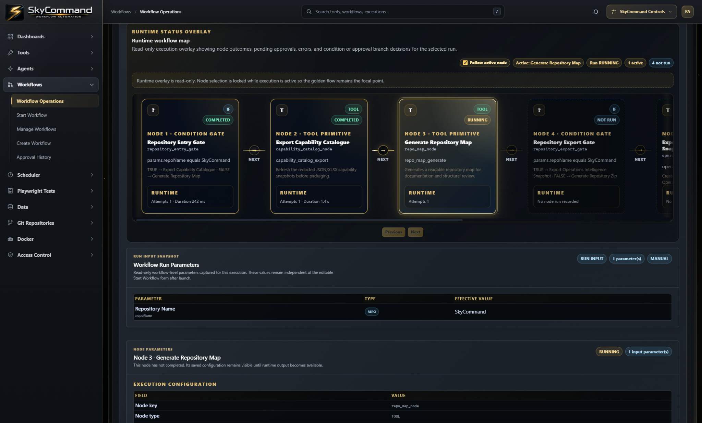
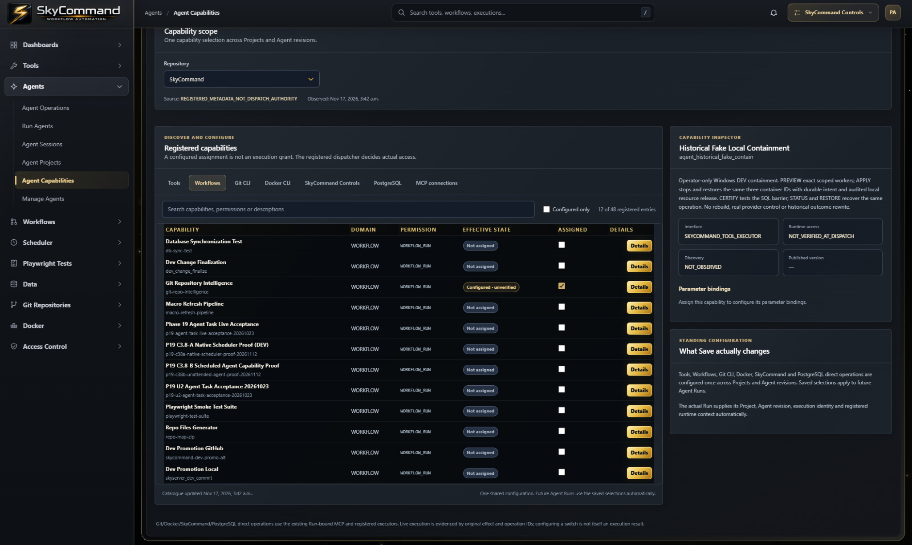

<picture>
  <source media="(prefers-reduced-motion: reduce) and (max-width: 650px)" srcset="./assets/brand/hero-mobile-static.svg" />
  <source media="(prefers-reduced-motion: reduce)" srcset="./assets/brand/hero-static.svg" />
  <source media="(max-width: 650px)" srcset="./assets/brand/hero-mobile.svg" />
  
</picture>

  <a href="#key-capabilities">Capabilities</a> ·
  <a href="#see-the-platform">Screenshots</a> ·
  <a href="#platform-architecture">Architecture</a> ·
  <a href="./docs/walkthrough.md">Walkthrough</a> ·
  <a href="mailto:paulsattaur@hotmail.com?subject=SkyCommand%20walkthrough">Get In Touch</a>

**Build workflows. Run agents. Understand every result.**

SkyCommand is a full-stack workflow automation and orchestration platform built by **Paul Sattaur** for developers and operators. It brings reusable tools, durable workflows, embedded AI agents and external MCP access into one interface for running work and inspecting its results.

**SkyCommand can call agents, and coding agents can call SkyCommand.** Combine repeatable execution with adaptive reasoning, configure the capabilities available to embedded agents, and follow the resulting workflow and node outcomes.

> **Public Showcase · Private Implementation.** This repository contains product documentation and presentation assets—not application source, an installable distribution or a hosted interactive demo.

## Key Capabilities

<picture>
  <source media="(prefers-reduced-motion: reduce) and (max-width: 650px)" srcset="./assets/brand/capabilities-mobile-static.svg" />
  <source media="(prefers-reduced-motion: reduce)" srcset="./assets/brand/capabilities-static.svg" />
  <source media="(max-width: 650px)" srcset="./assets/brand/capabilities-mobile.svg" />
  
</picture>

<strong>Read Capabilities as Text</strong>

| Capability | What It Enables |
|---|---|
| **Reusable Tools** | Compose registered operations with explicit inputs and results. |
| **Published Workflows** | Temporal-backed execution with retries, scheduling, recovery controls and configured approval steps. |
| **AI Agents** | Run embedded agents with access selected for a Project and exact Agent definition version. |
| **External MCP Access** | Let configured coding assistants invoke exposed operations and inspect results through MCP. |
| **Structured Results** | Inspect workflow outcomes, node results and attributable agent outputs. |
| **Operational Visibility** | Follow run history and diagnostics from the operator interface. |

[Explore the Feature Tour →](./docs/features.md)

## See the Platform

These are **real SkyCommand development-environment screenshots**. Personal inputs and sensitive paths are redacted. Captions identify the actual interface state shown in each capture.

*Command Center — tool and workflow activity, utilization, scheduling and performance.*

*Workflow Operations — the runtime overlay highlights a RUNNING node and earlier completed steps. This is not a completed-run capture.*

*Agent Capabilities — catalogued and assigned operations; the pictured historical test item is not verified at dispatch.*

[Browse All Ten Screenshots →](./docs/gallery.md) · [Follow the Illustrated Walkthrough →](./docs/walkthrough.md)

## Platform Architecture

<picture>
  <source media="(prefers-reduced-motion: reduce) and (max-width: 650px)" srcset="./assets/brand/architecture-mobile-static.svg" />
  <source media="(prefers-reduced-motion: reduce)" srcset="./assets/brand/architecture-static.svg" />
  <source media="(max-width: 650px)" srcset="./assets/brand/architecture-mobile.svg" />
  
</picture>

The access layer groups the React UI and Node.js Core API for clarity; **the UI calls platform services rather than bypassing them**. Configured coding assistants reach those services through MCP and can use the UI when their client supports browser interaction. Tools, embedded agents and published workflows form the callable execution layer. The resource groups show what automation can operate on—not unrestricted access for every agent.

**Core Stack:** React · Node.js / TypeScript · PostgreSQL · Temporal · Docker · REST APIs · MCP

This is a conceptual product view, not a deployment specification or live-status display. [Read the Architecture Overview →](./docs/architecture.md)

### Agent Integration and Capability Controls

Embedded Agent Runs use a **run-bound MCP connection** and capabilities assigned to a **Project + exact Agent definition version**. External coding assistants use a separate MCP connection and their own configured identity and permissions.

Assigned Tools and Workflows retain their complete execution contracts. Direct-operation controls govern direct access; they do not add duplicate checks inside an already enabled Tool or Workflow. Normal executor permissions and explicitly configured approvals remain in effect.

[Explore MCP and Agent Capabilities →](./docs/architecture.md#two-directions-of-agent-integration)

### Development Process and Phase 20

The current development process uses **Cloud Agent, Operator, Local Agent and a Dropbox artifact relay**, coordinated through structured prompts and work-order families. Scoped streams, dependencies, handoffs and execution evidence organize the work; the Operator initiates the Local Agent.

That development method is separate from the product architecture above. **Native work-order coordination inside SkyCommand is planned for Phase 20**, not presented as an already delivered feature.

[View the Development Process on My Profile →](https://github.com/PStar80) · [Read About Work-Order Coordination →](./docs/architecture.md#work-order-coordination)

## Walkthrough and Documentation

Start with the [feature tour](./docs/features.md), follow the [walkthrough guide](./docs/walkthrough.md), or inspect the [architecture and capability model](./docs/architecture.md). The walkthrough covers a workflow run, structured results, embedded-agent capabilities and external MCP access.

## Why the Source Is Private

The application implementation and connected development environment remain private. This repository provides a public window into the product through documentation, architecture and reviewed demonstration material, without publishing account configuration, credentials or private work artifacts.

The banner is decorative artwork; the diagrams explain concepts. Neither should be read as an application screenshot or proof of live execution.

## About the Builder

I'm **Paul Sattaur**, a full-stack software engineer building connected applications for workflow automation, data engineering and interactive visualization. My current focus is AI-native applications and agentic automation—from the user experience to the services and data that power it.

[GitHub Profile](https://github.com/PStar80) · [LinkedIn](https://www.linkedin.com/in/paulsattaur/) · [Request a Walkthrough](mailto:paulsattaur@hotmail.com?subject=SkyCommand%20walkthrough)

**Build systems that explain themselves.**
