<picture>
  <source media="(prefers-reduced-motion: reduce) and (max-width: 650px)" srcset="./assets/brand/hero-mobile-static.svg" />
  <source media="(prefers-reduced-motion: reduce)" srcset="./assets/brand/hero-static.svg" />
  <source media="(max-width: 650px)" srcset="./assets/brand/hero-mobile.svg" />
  
</picture>

<p align="center">
  <a href="./docs/features.md">Feature tour</a> ·
  <a href="./docs/architecture.md">Architecture</a> ·
  <a href="./docs/walkthrough.md">Walkthrough</a> ·
  <a href="./docs/gallery.md">Screenshots</a> ·
  <a href="mailto:paulsattaur@hotmail.com?subject=SkyCommand%20walkthrough">Get in touch</a>
</p>

# SkyCommand

**Build workflows. See what ran. Understand what happened.**

SkyCommand is an independent workflow automation and orchestration platform built by **Paul Sattaur**. It brings reusable tools, durable workflows, optional embedded AI agents, MCP access for external coding agents, and operational visibility into one developer-focused platform.

The guiding principle is simple: **deterministic workflows by default; AI agents where adaptive reasoning is useful.**

> **Public showcase, private implementation.** This repository contains product documentation and presentation assets. It is not the application source, an installable distribution, or a hosted interactive demo.

## What it does

| Capability | What it brings to the workflow |
|---|---|
| **Durable orchestration** | Temporal-backed execution with retries, approvals, recovery controls, and scheduling. |
| **Reusable tools** | Tools composed into workflows rather than repeated as disconnected manual steps. |
| **Optional embedded agents** | Adaptive work inside a workflow, with configured access to Tools, Workflows and supported direct operations. |
| **External coding-agent access** | Coding assistants can use SkyCommand directly through MCP to invoke exposed operations and inspect results under their configured authority. |
| **Agent Capabilities** | Project + Agent-version assignments distinguish enabled Tools/Workflows from supported direct-operation permissions. |
| **Execution visibility** | Run history, node results, structured outputs, and operational diagnostics. |
| **Developer workflows** | Git and Docker operations alongside database-backed services and operational tooling. |
| **Human control** | Review and approval steps where a workflow calls for an operator's decision. |

[Explore the feature tour →](./docs/features.md)

## How it fits together

```text
Human operator → React UI ─────────────┐
                                      ├→ SkyCommand Core API / services
External coding agent → external MCP ─┘       ├→ Registered Tools
                                             └→ Published Workflows (Temporal)
                                                       └→ Optional embedded Agent
                                                             └→ Run-bound MCP
                                                                  └→ Configured capabilities

PostgreSQL: workflow/run state, results and capability assignments
Docker / Host services: registered operational execution
```

This is a simplified conceptual view, not a deployment specification. [Read the architecture overview →](./docs/architecture.md)

**Core stack:** React · Node.js / TypeScript · PostgreSQL · Temporal · Docker · REST APIs · MCP

## Agents in both directions

**SkyCommand can call agents, and coding agents can call SkyCommand.** External coding assistants use an MCP connection to existing registered services. Embedded Agent Runs use a separate, run-bound MCP connection and their configured Project + Agent-version capabilities.

Capability configuration limits what the embedded agent may invoke. Assigned Tools and Workflows run under their complete existing contracts; direct-operation controls apply to direct access rather than adding duplicate checks inside those operations. Normal executor permissions and explicitly configured approvals remain in effect.

[Read the MCP and capability architecture →](./docs/architecture.md#two-directions-of-agent-integration)

## Work orders: current method, Phase 20 direction

The development process already uses **structured prompts and work-order families** to coordinate scoped work streams, role-specific handoffs, dependencies, execution state and review evidence. One accountable writer per shared checkout protects unrelated work; successful execution and accepted delivery remain distinct.

**Planned for Phase 20:** bring this existing work-order coordination model into SkyCommand as a native capability. The process is in use today; native product integration is planned, not presented here as delivered.

[Explore work-order coordination →](./docs/architecture.md#work-order-coordination)

## See the platform

The [walkthrough](./docs/walkthrough.md) outlines a representative demonstration: run a deterministic workflow, inspect its results, show configured embedded-agent access, and use an external coding assistant through MCP. It keeps the current development work-order process separate from the Phase 20 roadmap.

**UI screenshots have not been published in this initial documentation package.** The [gallery](./docs/gallery.md) will contain reviewed captures from the actual application. The header is decorative concept artwork—not an application screenshot.

## Engineering approach

- Keep repeatable execution deterministic; introduce agents deliberately.
- Make execution observable through run history and structured results.
- Design for retries, recovery, and operator review.
- Keep implementation, validation, and release decisions accountable to a human.

## Project scope

SkyCommand is an independently developed platform. This repository focuses on its design, capabilities, and operator experience. The application implementation and development environment remain private.

## About the builder

I'm **Paul Sattaur**, a software engineer based in the Greater Toronto Area. My work combines enterprise backend and database experience with hands-on workflow orchestration, full-stack development, and AI-assisted engineering.

[GitHub profile](https://github.com/PStar80) · [LinkedIn](https://www.linkedin.com/in/paulsattaur/) · [Request a walkthrough](mailto:paulsattaur@hotmail.com?subject=SkyCommand%20walkthrough)

**Build systems that explain themselves.**
