# Architecture Overview

[← Showcase Home](../README.md)

SkyCommand is both an **execution platform for embedded AI agents** and an **MCP-accessible platform that external coding agents can operate**. Deterministic tools and workflows remain the default execution path; agent execution is available when the selected operation or workflow calls for it.

This is a conceptual architecture, not a deployment specification. It omits account configuration, credentials, host addresses, private repository contents, and operational identifiers.

## Platform View

<picture>
  <source media="(prefers-reduced-motion: reduce) and (max-width: 650px)" srcset="../assets/brand/architecture-mobile-static.svg" />
  <source media="(prefers-reduced-motion: reduce)" srcset="../assets/brand/architecture-static.svg" />
  <source media="(max-width: 650px)" srcset="../assets/brand/architecture-mobile.svg" />
  
</picture>

The combined **React UI / Node.js Core API** box represents shared access to platform services, not a bypass around the API. The UI calls those services; configured coding assistants can invoke them through MCP and use the UI when their client supports browser interaction.

**Registered Tools**, **AI Agents** and **Published Workflows** are grouped as callable execution capabilities. **File System**, **Database**, **Git Repositories** and **Web APIs** are resource categories automation can operate on. These categories do not imply that every agent has direct access to every resource. PostgreSQL remains the platform's database technology; the diagram uses the broader label Database to describe the endpoint category.

## Two directions of agent integration

### External coding agents → SkyCommand

A configured external coding assistant can use SkyCommand through **Model Context Protocol (MCP)**. Rather than merely generating code or asking a person to click through the interface, the assistant can invoke exposed registered operations, start published workflows, and inspect returned execution results within its configured authority.

The external MCP connection and React operator interface reach the platform's existing services and executors. They are alternative interaction paths, not separate workflow engines. Registered tools, embedded-agent runs and published workflows are callable through the platform services shown above.

External clients use their own configured identity, available methods and execution permissions. Connecting through MCP does not itself grant unrestricted platform access.

### SkyCommand → embedded agents → configured capabilities

A workflow can include an Agent Task. The resulting embedded Agent Run uses a **run-bound MCP connection** to invoke the capabilities selected for its Project and exact Agent definition version. Agent steps are selected where adaptive work is useful; deterministic workflows do not need to invoke an agent.

```text
Workflow → Agent Task → embedded Agent Run
                              │
                     run-bound MCP gateway
                              │
            Project + Agent-version configuration
                  ├→ Assigned registered Tools
                  ├→ Assigned published Workflows
                  └→ Enabled direct operations, where supported
                              │
                 Existing registered executors
                              │
               Attributable results → parent workflow
```

The external-assistant and embedded-agent connections are **separate transports over shared registrations**. They do not imply identical permissions, universal coding-agent parity, or automatic inheritance of an external client's local access.

## Agent capability configuration

Agent Capabilities defines what the selected **Project + Agent definition version** can invoke through the embedded integration. It distinguishes three kinds of access:

| Capability type | Meaning |
|---|---|
| **Tools** | Assign an existing registered Tool and its parameters. The Tool executes under its normal contract and executor permissions. |
| **Workflows** | Assign a published Workflow. Its configured graph runs through the existing workflow engine, including its nested operations. |
| **Direct operations** | Select supported actions and registered targets for direct Git, Docker, named SkyCommand Controls, or PostgreSQL access, where the corresponding adapter is available. |

Direct PostgreSQL controls distinguish relation actions such as SELECT/INSERT/UPDATE/DELETE from named routine EXECUTE. Direct-operation availability depends on the implemented adapter, registered target, configuration and underlying executor privileges; listing a domain is not a claim that every possible command has been implemented or proven.

**Direct access is not the same as access inside an assigned Tool or Workflow.** Disabling a direct database action limits that direct route. It does not remove a database operation that is already part of an enabled Tool or published Workflow's normal contract. The same distinction applies to other direct-operation domains.

Permitted calls use standing configuration without an extra per-call approval ceremony. Explicitly configured approval nodes and normal platform/executor permissions still apply. MCP provides the connection; it is not a separate source of permission. These controls are not a blanket sandbox around every external program or coding assistant.

## Work-order coordination

### Current development method

The **Development Process Flow** on [Paul's profile](https://github.com/PStar80) describes the current cloud/local operating method, rather than the internal product architecture above. **Cloud Agent** communicates with the **Operator** and shares work artifacts through **Dropbox** with the **Local Agent**. The Operator initiates the Local Agent. Operator and Local Agent can then use SkyCommand's shared interface and API services.

SkyCommand is developed using a **structured prompt and work-order architecture** that coordinates multiple scoped work streams. It is an operating method used in development today, not a claim that a native work-order management interface has already shipped.

A work order defines the outcome, source scope, execution target, roles, permitted operations and acceptance criteria. Related work stays in a work-order family through implementation, corrections, review and delivery. The current CLOUD coding mode separates cloud-authored exact source from local installation, execution, focused verification and operational recovery.

| Record or practice | Responsibility |
|---|---|
| **Work-order manifest** | Record the approved revision, repository/path scope, assigned roles, dependencies, execution surfaces and operation limits. |
| **Work-order state** | Record the actual attempt, execution phase, outcome, blocker and evidence. It is not a new approval. |
| **Family state** | Coordinate related orders, membership, stage, active claims and closure. Stage records progress, not permission. |
| **Scoped work streams** | Preserve unrelated changes, track dependencies and keep one accountable writer per shared checkout. |
| **Evidence and handoff** | Carry genuine run results, receipts and review decisions forward rather than relying on chat history alone. |

```text
Owner outcome → coordinator / structured work order
                    ├→ Scoped work stream A
                    └→ Scoped work stream B
                         │
                Assigned executor + focused checks
                         │
                Results / evidence → review
                         │
            Separately authorized promotion, when required
```

The family lifecycle is **BACKLOG → READY → ACTIVE → REVIEW → COMPLETED**. Explicit dependencies and source ownership coordinate the streams; they do not imply concurrent writes are safe in the same checkout. Source delivery requiring promotion retains its separate owner-authorized release decision. Work-order records describe scope and progress; they do not expand runtime permissions or act as distributed locks.

### Phase 20 — planned native integration

**Phase 20 is planned to bring this existing work-order coordination model into SkyCommand itself.** The direction is native management of work-order families, scoped work streams, handoffs, dependencies and execution evidence using the established platform.

This is roadmap information, not a completed product feature or a promise that agents already delegate unrestricted work to one another. The current MCP connections, embedded-agent capability configuration and development work-order method should be evaluated separately from that planned integration.

## Main components

| Component | Responsibility |
|---|---|
| **React operator interface** | Workflow operations, Agent Capabilities configuration, run history and structured results. |
| **Node.js Core API / services** | Connect operator and agent requests to registered platform operations. |
| **MCP connections** | External coding-assistant access and separate run-bound embedded-agent access. |
| **Temporal** | Durable execution of published workflows, including retry and recovery behaviour. |
| **Registered Tools and executors** | Reusable operations with explicit inputs and normal execution constraints. |
| **Embedded Agent Runs** | Execute configured agent tasks and return attributable results. |
| **PostgreSQL** | Workflow definitions, execution metadata, results and capability assignments. |
| **Automation Endpoints** | File system, database, Git repository and web API resources exposed through supported operations and permissions. |
| **Docker / Host services** | Containerized services and supported registered operational controls. |

## Engineering approach

Repeatable operations stay deterministic. Agents contribute reasoning where useful. Tools do one job; workflows own composition, ordering, retries and explicit result mappings. Run identities and structured outcomes keep execution inspectable, and uncertain effects are reconciled before retrying.

## Public showcase boundary

This repository contains documentation and presentation assets, not runtime services, database dumps, source code, account connections or private work-order payloads. Screenshots and demonstrations will show selected real behaviour without exposing the underlying environment.

[Feature Tour](./features.md) · [Walkthrough](./walkthrough.md) · [Screenshot Gallery](./gallery.md)
