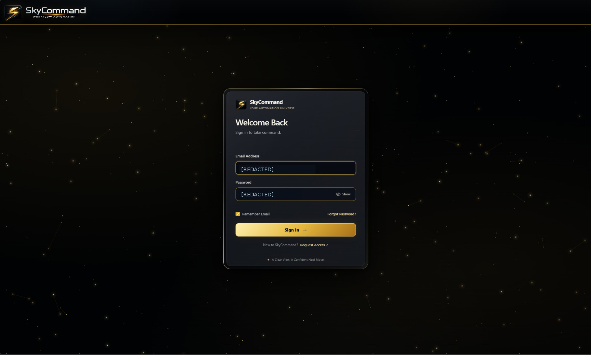
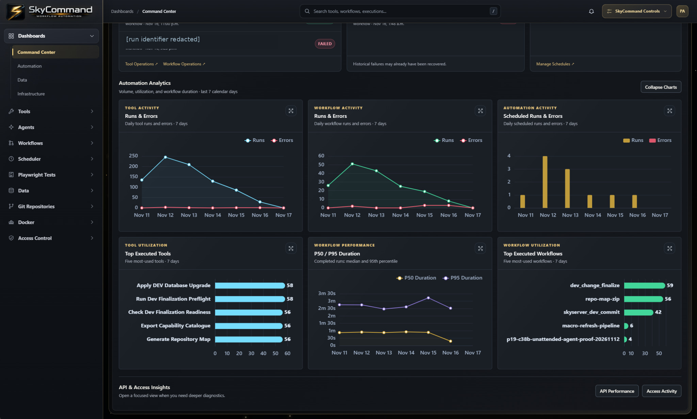
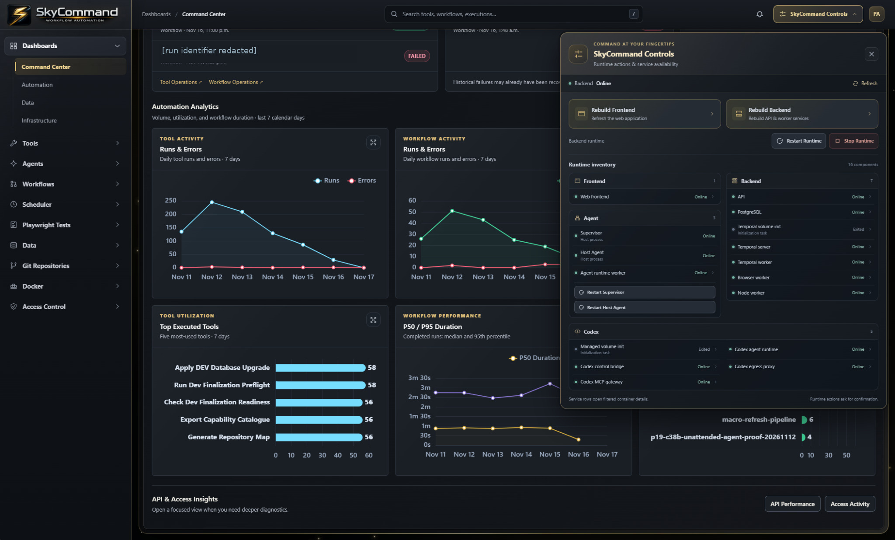
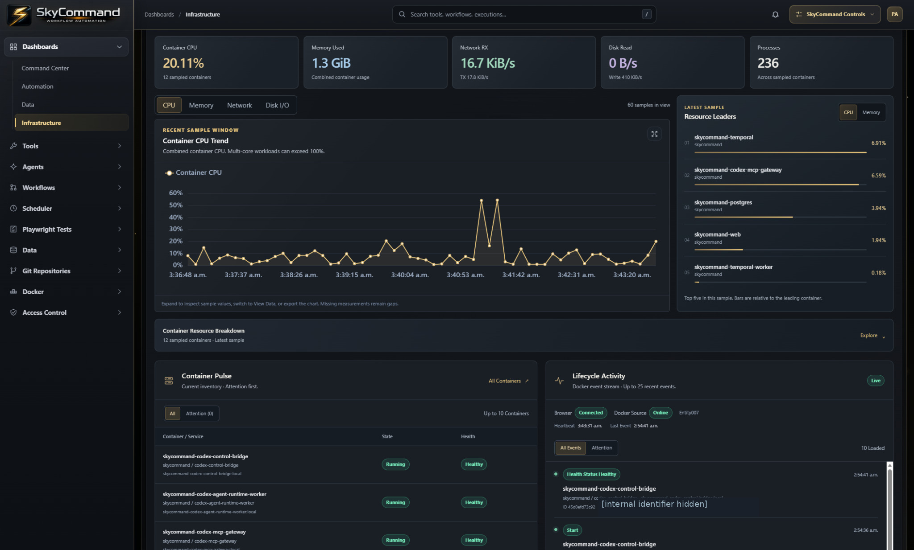
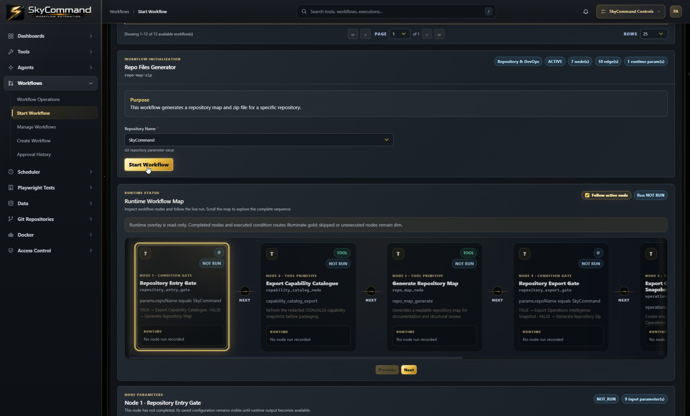
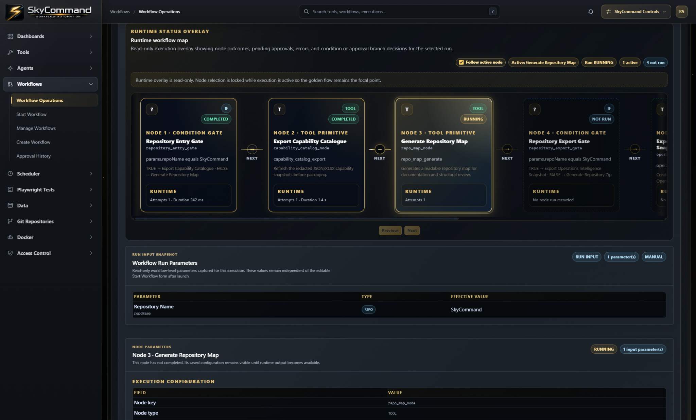
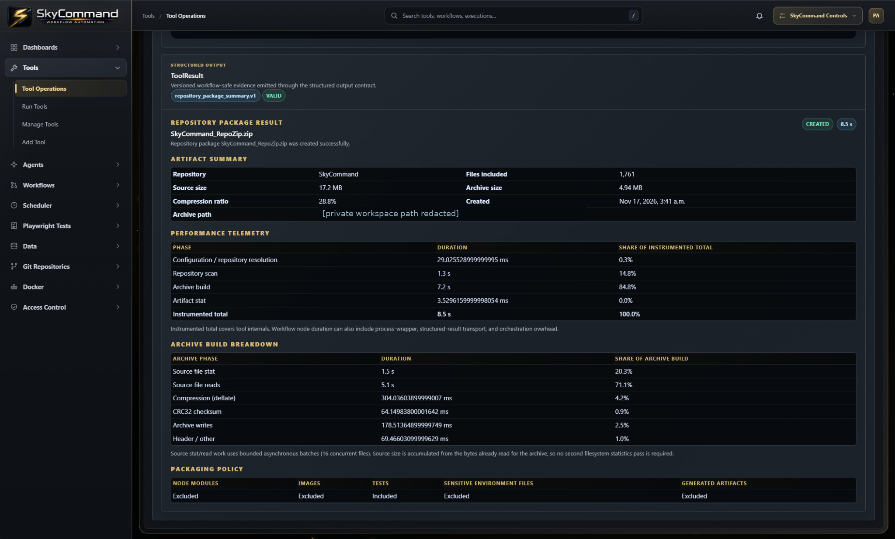
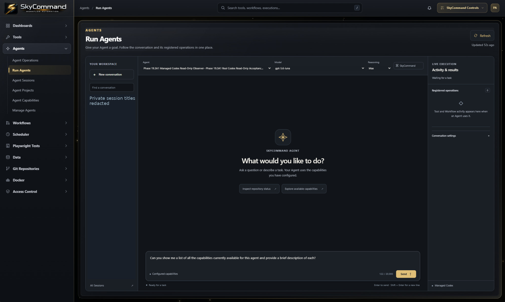
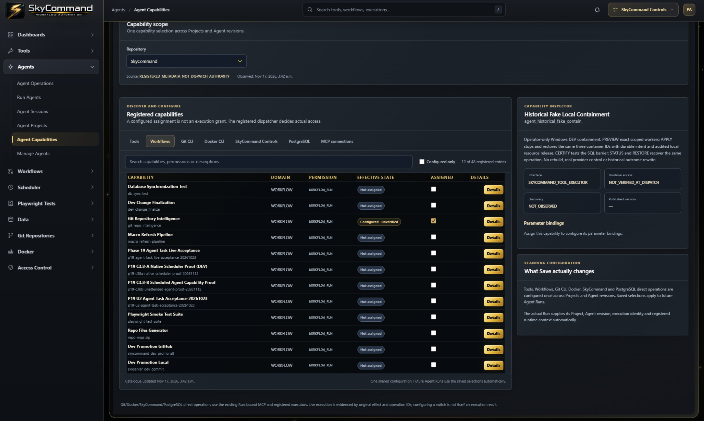
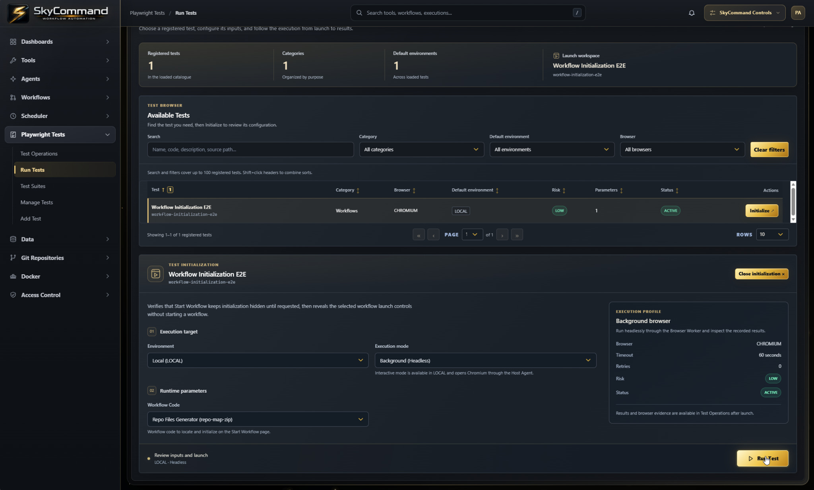

# Screenshot Gallery

[← Showcase Home](../README.md) · [Walkthrough](./walkthrough.md) · [Architecture](./architecture.md)

These are **real screenshots from a SkyCommand development environment**, captured on November 17, 2026. They show point-in-time interface states, not a hosted demo or proof that every listed capability is available in the latest release. Sensitive inputs, conversation titles, local paths, and selected internal identifiers have been permanently redacted in these published copies.

**The live workflow graph and the completed ToolResult come from separate captures.** The images do not document a single end-to-end run, and no external MCP invocation is pictured here. Read the [MCP architecture](./architecture.md) for that integration.

## Interface and operations

### 01. Login Screen

Login page and star-field styling; entered account information and password field redacted.

### 02. Command Center

Automation analytics: tool activity, workflow volume, scheduled runs, utilization and duration.

### 03. SkyCommand Controls

Runtime actions and component inventory opened from the Command Center. Captured status values are point-in-time.

### 04. Infrastructure

Container resource sampling, process metrics, container pulse and lifecycle events.

## Workflow execution and structured results

### 05. Start Workflow

Repo Files Generator configuration, selected repository and read-only workflow map before launch.

### 06. Workflow Running

Workflow Operations runtime overlay: earlier nodes completed while Generate Repository Map is RUNNING.

### 07. Structured Tool Result

Successful repository package ToolResult with artifact summary, stage timing and packaging policy; internal path redacted. This is a separate tool result from the running-workflow capture.

## AI-agent interfaces

### 08. Run Agents

Agent conversation workspace and activity/results panel. Earlier conversation titles redacted; this capture does not show an active agent run.

### 09. Agent Capabilities

Capability assignment catalogue and inspector. The selected historical test fixture is marked NOT_VERIFIED_AT_DISPATCH; configuration does not alone prove live permission.

## Browser testing

### 10. Playwright Tests

The supplied development-build capture shows the Playwright Tests → Run Tests page, with Workflow Initialization E2E selected, a Chromium execution profile and launch controls. This is a test-configuration view; it does not show a completed test or its outcome.

## What the screenshots do not establish

- **External MCP invocation:** The supplied images show agent-facing UI, but no coding-agent MCP call and its matching SkyCommand execution receipt.
- **Completed workflow run:** The workflow graph is captured while a node is running. The separate ToolResult is not presented as the final node output of that same execution.
- **Capability enforcement:** Assignment and discovery views show configuration, not an independent runtime authorization test.
- **Test outcome:** The Playwright Tests capture shows configuration and a Run Test control, not a completed browser test. The capture alone does not establish the feature's release/support status.

The blue-metallic hero and diagrams are **conceptual presentation artwork**, kept separate from these real application captures.

[Feature Tour](./features.md) · [Walkthrough Guide](./walkthrough.md)
